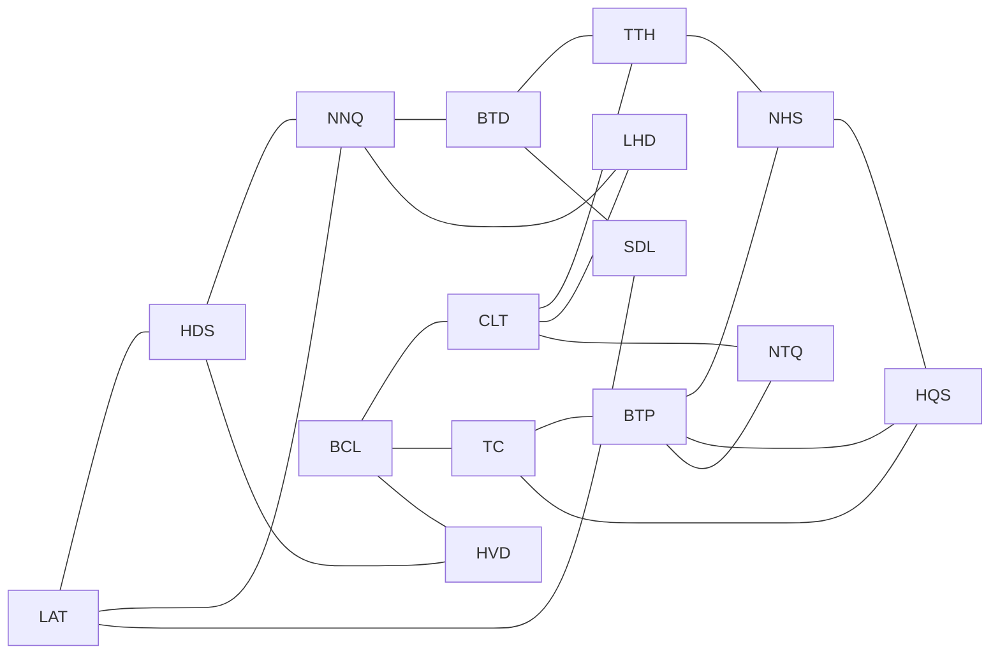

# Tây Du Ký v2 — Báo cáo tổng thể 15 vùng để phê duyệt

> **Cập nhật triển khai 20/11/2026:** Chủ dự án sau đó yêu cầu thực hiện khung 15 vùng và Thiên Cung. Các bảng sơ đồ/tiếp giáp bên dưới vẫn là phương án lịch sử, không phải hiện trạng. Đồ thị hiện hành được suy ra từ mask thực và có 31 cạnh; xem [trạng thái v2](v2/STATUS.md) và `tests/tayduky-v2-map15.mjs`. Tám vùng gốc còn lại và bốn vùng bổ sung vẫn là ô tạm; mọi cảnh quan tương lai còn mở.

**Ngày:** 20/11/2026 · **Trạng thái:** bản thiết kế và các phương án xin ý kiến; chưa cho phép xây thêm vùng. 11 vùng đầu giữ nguyên danh mục gốc; bốn vùng bổ sung chỉ là đề xuất. Bản này không sửa quyết định hay sự kiện cũ.

## Cách đọc trạng thái

- **[APPROVED]** Đã có quyết định của chủ dự án trong tài liệu gốc hoặc chỉ thị hiện hành. Đây là phê duyệt về hướng thiết kế, không có nghĩa đã hoàn thành trong v2.
- **[IMPLEMENTED]** Có bằng chứng trong v2 hiện hành. Không có nghĩa đã được duyệt mỹ thuật cuối cùng.
- **[MISSING]** Nội dung đã định trong thiết kế gốc nhưng chưa tìm thấy trong v2, hoặc mới có một phần; không xóa khỏi phạm vi.
- **[PROPOSED]** Chi tiết mới, bao gồm toàn bộ bốn vùng thêm, bảng màu HEX cụ thể, kích thước, vị trí, tiếp giáp và các bước còn thiếu trong kịch bản gốc. Cần duyệt trước khi triển khai.

**Nguồn và thứ tự đọc:** [thiết kế gốc D1–D18 và §4](TAYDUKY-DESIGN.md), [redesign v2](v2/REDESIGN.md), [trạng thái v2](v2/STATUS.md), [thư viện](v2/ASSET-LIBRARY.md), [PixelLab](v2/PIXELLAB.md), [handoff](../../tayduky/AI_HANDOFF.md), [quy tắc vùng](../../tayduky/AGENTS.md), và dữ liệu chạy thực tế [tw-data.js](../../tayduky/tw-data.js), [tw-map.js](../../tayduky/tw-map.js), [tw-sim.js](../../tayduky/tw-sim.js). `docs/tayduky/STATUS.md` và `art-pilot/README.md` mô tả alpha cũ, không chứng minh v2 đã có 11 vùng sống. Handoff là ảnh chụp cũ: hai commit `8452a9e`, `aad60ef` đã bổ sung cast, thư viện và action sau đó. Báo cáo này là bản đối chiếu, không phải kết quả benchmark hay kiểm thử mới.

## 1. Ràng buộc toàn thế giới

**[APPROVED]** Một bản đồ liên tục 160×160 ô, quan sát thụ động; isometric 2:1, camera, mức zoom mặc định, tỷ lệ nhân vật và thanh UI/nhạc giữ nguyên. V2 dùng T=8 đơn vị/ô, K=4 art pixel/đơn vị, mặt ô 64×32 pixel; không nhầm K=2 trong số liệu lịch sử của bản gốc với thông số v2. Không có điều khiển cư dân, mục tiêu, nhật ký, danh sách sự kiện hay camera tự bay. Các phiên bản Ngộ Không có thể xuất hiện ở nhiều vùng; không cần đoàn liên tục đi xuyên bản đồ (D1, D6, D12–D13).

**[APPROVED]** Ba lớp đời sống: hoạt động thường xuyên, mini-event, signature. Mỗi vòng: yên bình → báo trước → diễn biến → dư âm → phục hồi dần; reset câu chuyện chứ không reset thế giới, mục tiêu 5–10 phút. Global Story Director tối đa 5 signature; vùng chung cạnh không được đồng thời ở giai đoạn báo trước/signature. Không có vùng tĩnh (D7–D9, D15, D17). Các hiệu ứng báo trước cần đọc được từ xa, không cần ticker. Hình tượng Phật, Quan Âm trang nghiêm; yêu quái rút lui hoặc tan thành khói, không máu me.

**[APPROVED]** Vùng trời nằm trên mặt đất, dùng mây/ánh sáng để tạo cảm giác cao; bờ chuyển tiếp mang cả hai bảng màu; một đồng hồ toàn cục, thời tiết được từng vùng diễn giải; mùa chỉ áp dụng cho vùng trần gian theo thiết kế gốc (D4–D5, D10). Nhãn địa danh song ngữ và biểu tượng giúp người chưa đọc truyện nhận biết (D14). Lôi Âm Tự vẫn là công trình lớn nhất (D16); tên gallery D18 giữ nguyên.

**[PROPOSED]** Vùng nhỏ, dày và không bằng nhau; không thu nhỏ nhân vật, công trình hoặc thác hiện hữu để nhét đủ 15 vùng. Giữ hai footprint v2 tại chỗ; ưu tiên lấy đất chưa dựng từ các ô tạm. Kích thước dưới đây là **khung bao dự kiến theo ô trên lưới**, không phải diện tích hình chữ nhật được cấp phát: mask cong, dải bờ và phần nước dùng chung có thể nằm trong nhiều khung bao. Chưa có bản phân hoạch tile chứng minh 15 mask vừa, không xâm phạm hai vùng hay giữ mọi tiếp giáp; cần nguyên mẫu sơ đồ đo diện tích trước khi khóa. Dải pha màu 4–6 ô là mục tiêu gốc, có thể cần hẹp cục bộ sau khi đo, phải xin duyệt nếu thay đổi.

**[PROPOSED]** Phong cách thần thoại Trung Hoa pixel-art nguyên gốc: nét viền mận `#2A1726`, sáng trên trái, bóng đổi sắc, nền dịu hơn nhân vật; không đồ lại hình tham khảo hay ghép mảng cảnh phẳng. Cây, nước, kiến trúc và động vật đều có chuyển động đọc được, nhưng tiết chế trong cảnh đông. Dùng lại sprite, mặt nạ sáng/tơ/lá, sheet bốn hướng, neo chân và công cụ đóng gói hiện có; sprite và địa hình là đối tượng riêng, có tọa độ, va chạm và thứ tự sâu. Asset mới cần nguồn, giấy phép, ID, cân đối chi phí và kiểm tra tương thích; không tạo asset trong đợt này. Bảng HEX dưới đây là **đề xuất triển khai** các họ màu đã duyệt, không phải mã màu đã được chủ dự án ký duyệt.

**Đối chiếu đủ D1–D18:** D1 một thế giới liên tục, tự do quan sát; D2 toàn bộ 11 vùng gốc thuộc phạm vi dài hạn, không xem lát cắt hai vùng là thay thế; D3 mỗi vùng có bản sắc màu; D4 bờ pha hai vùng; D5 vùng trời trên mặt đất; D6 cast riêng từng vùng; D7 ba lớp hoạt động; D8 vòng đời và phục hồi liên tục; D9 trần năm, không kề; D10 thời gian/thời tiết toàn cục và mùa phân vùng; D11 mục tiêu thấy 3–5 vùng khi zoom rộng **chưa đạt**; D12 không thêm điều khiển sự kiện, nhật ký hay cài đặt riêng; D13 bản đồ 160×160, kích thước vùng thay đổi cần duyệt khi thêm bốn vùng; D14 biển hiệu/biểu tượng/thẻ tên dễ hiểu; D15 vòng 5–10 phút; D16 đại điện Lôi Âm Tự lớn nhất; D17 mọi vùng đều sống động; D18 tên gallery song ngữ giữ nguyên. Các mâu thuẫn hoặc thay đổi cần quyết định được đưa vào §7.

## 2. Bảng so sánh và ngân sách không gian sơ bộ

| Mã | Vùng | Nhận diện chính | Khung bao dự kiến, ô | Vị trí tương đối | Tình trạng v2 |
|---|---|---|---|---|---|
| HQS | Hoa Quả Sơn | thác, đào, khỉ | ~36×36 hiện hữu | mũi đông | [IMPLEMENTED] lát cắt; chờ duyệt hình |
| TC | Thiên Cung / Vườn Đào | cổng trời, đào, lò | 34×30 | đông bắc | [APPROVED] ý tưởng; [MISSING] vùng sống |
| BTP | Lòng bàn tay Phật Tổ | năm cột ngón tay | 24×23 | trên NHS | [APPROVED]; [MISSING] |
| NHS | Ngũ Hành Sơn | năm đỉnh, bùa | 29×27 | mép dưới đông | [APPROVED]; [MISSING] |
| CLT | Cao Lão Trang | ruộng, sân nhà họ Cao | 34×30 | trung tâm đông | [APPROVED]; [MISSING] |
| BCL | Bạch Cốt Lĩnh | vòm xương, sương | 30×26 | trung bắc | [APPROVED]; [MISSING] |
| NNQ | Nữ Nhi Quốc | cung đỏ, hồ sen | 34×31 | trung tây | [APPROVED]; [MISSING] |
| BTD | Bàn Tơ Động | võng tơ, hang | ~39×38 hiện hữu | tây nam | [IMPLEMENTED] lát cắt; chờ duyệt hình |
| HDS | Hỏa Diệm Sơn | núi lửa, quạt Ba Tiêu | 31×28 | tây bắc | [APPROVED]; [MISSING] |
| TTH | Thông Thiên Hà | sông, thuyền, rùa | 37×23, kéo dài | mép dưới | [APPROVED]; [MISSING] |
| LAT | Lôi Âm Tự | đại điện vàng, kinh | 38×33 | mũi tây | [APPROVED]; [MISSING] |
| NTQ | Ngũ Trang Quán | cây nhân sâm | 26×25 | giữa CLT–BTP | [PROPOSED] vùng mới |
| HVD | Hỏa Vân Động | hang Hồng Hài Nhi, lửa tam muội | 25×24 | giữa HDS–BCL | [PROPOSED] vùng mới |
| LHD | Liên Hoa Động | hang hồ lô, hai sừng | 25×24 | giữa NNQ–CLT | [PROPOSED] vùng mới |
| SDL | Sư Đà Lĩnh | thành yêu, ba đại vương | 30×27 | giữa LAT–BTD | [PROPOSED] vùng mới |

Các vùng mới chiếm không gian từng dành cho ô tạm, không thêm vùng ngoài bản đồ. Dự toán thực tế phải cộng diện tích mask, đường, dải bờ, vùng đi lại và biển/mây không chồng lấn trên 25.600 ô; không cộng diện tích khung bao trong bảng vì chúng chồng và rỗng. Những con số không phải tọa độ hay cam kết sức chứa.

## 3. Sơ đồ địa lý và đồ thị tiếp giáp đề xuất

**[PROPOSED]** Sơ đồ dưới chỉ là sơ đồ ý tưởng trên màn hình, không phải bản raster, không dùng để suy ra cạnh chung. Tây ở trái, đông ở phải; giữ mũi LAT/HQS, TC cạnh HQS, BTP trên NHS, NHS chạm biên dưới, TTH dọc biên dưới hướng Đông Hải và vùng trời trên đất như gốc. BTD/HQS và hình dạng của chúng không bị di chuyển theo bản vẽ này. Bốn vùng mới nằm ở vùng ô tạm; thứ tự là gần đúng, không khẳng định đường đi đoàn hành hương liên tục.

```text
                         BẮC / phía sau màn hình
                HDS —— HVD —— BCL —— TC
              /       [hang lửa]       \  \
   TÂY  LAT      NNQ —— LHD —— CLT —— NTQ —— BTP      HQS  ĐÔNG / biển
             \                  |                  NHS
              SDL —— BTD —— TTH ————————————————/      NAM / mép dưới
```

**Quan trọng:** hình chữ trên không thể hiện đầy đủ các cạnh và không phải bằng chứng khả thi hình học. Danh sách sau là **nguồn chân lý của phương án đồ thị**, hai chiều, chỉ tính **chung cạnh thực** sau phân hoạch, không tính chạm góc hay chỉ thấy qua nước/mây. Nếu một dải nước thuộc vùng khác hoặc chỉ là ranh giới đồ họa, quyết định tiếp giáp phải theo ô vùng thực tế. Trong phương án này các cạnh gốc HDS–BCL, NNQ–CLT, CLT–BTP, LAT–BTD bị **thay tạm thời** bằng đường hai cạnh qua HVD, LHD, NTQ, SDL; thay đổi này cần được duyệt, không phải thực trạng hay quyết định đã có. Các cạnh gốc còn lại giữ như §2.3; bản vẽ mask thực tế có thể làm phát sinh cạnh khác, phải sửa bảng và kiểm tra lại trước khi dùng Director.

| Vùng | Các vùng chung cạnh theo phương án |
|---|---|
| LAT | HDS, NNQ, SDL |
| HDS | LAT, NNQ, HVD |
| NNQ | LAT, HDS, BTD, LHD |
| BTD | NNQ, TTH, SDL |
| BCL | CLT, TC, HVD |
| CLT | BCL, TTH, LHD, NTQ |
| TTH | BTD, CLT, NHS |
| TC | BCL, BTP, HQS |
| BTP | TC, NHS, HQS, NTQ |
| NHS | TTH, BTP, HQS |
| HQS | TC, BTP, NHS |
| HVD | HDS, BCL |
| LHD | NNQ, CLT |
| NTQ | CLT, BTP |
| SDL | LAT, BTD |

Đồ thị này đối xứng theo danh sách trên; ví dụ **LAT + BTD + CLT + TC + NHS** là năm đỉnh đôi một không kề trong phương án, nên mức trần 5 về mặt đồ thị vẫn có thể đạt. Đây không chứng minh năm signature thực tế sẽ cùng chạy hoặc bản đồ vật lý sẽ tạo đúng đồ thị. Trước khi triển khai cần sinh đồ thị từ các cạnh ô sau khi mask hoàn tất, so sánh hai chiều, kiểm tra không vùng nào bị cô lập, kiểm tra đường đi/bờ, và mô phỏng seed dài để đo số lần vi phạm và độ đói lịch; Director phải dùng đồ thị thực tế, kể cả cạnh bổ sung.



## 4. Hồ sơ chi tiết từng vùng

Quy ước dưới đây: bảng màu luôn [PROPOSED]; ánh sáng ngày/đêm và diễn giải thời tiết theo họ màu, quy tắc mùa trong §3–§5 của tài liệu gốc là [APPROVED] cho 11 vùng. Mỗi câu chuyện gốc chưa chạy được gắn [APPROVED, MISSING]; các nhịp dẫn và phục hồi chưa đặc tả được ghi [PROPOSED] trong cùng dòng, không giả làm chi tiết đã duyệt. Đối với bốn vùng mới, toàn bộ hồ sơ là [PROPOSED].

### 4.1 Hoa Quả Sơn — HQS

- **[APPROVED, IMPLEMENTED] Bản sắc:** quê Đại Thánh; bậc đá ngọc, Thủy Liêm Động sau thác, vườn đào, ngai, điện khỉ, xóm nhà sàn và bờ Đông Hải. Thác, camera và tỷ lệ hiện hữu phải giữ.
- **Màu [PROPOSED]:** `#467B55` ngọc, `#8DBB7D` lá, `#F1A9BD` đào, `#D4EDE7` thác, `#8C6C50` đá, `#E7BD63` nắng. Ngày nắng ấm, đêm thác xanh và đom đóm; mưa thật, gió cuốn cánh hoa, bốn mùa trần gian [APPROVED; thời tiết/mùa v2 MISSING].
- **[IMPLEMENTED] Cư dân:** Ngộ Không, 3 lính, 2 khỉ lão, 6 khỉ con, 10 dân; chim/bướm môi trường. Vua luyện gậy/thăm đàn/ngồi ngai; lính tuần; trẻ leo, đuổi, tắm; dân hái, chải lông, câu cá, vào nhà.
- **Đời sống [IMPLEMENTED]:** thác chảy và sương; cành đào/tre lay, cánh hoa rơi; trẻ leo khung chơi; khỉ leo cây hoặc vách; dân đi chợ/câu cá; lính tập hình nộm; đèn nhấp nháy.
- **Mini [IMPLEMENTED]:** Cướp đào: trẻ rung cây, bạn đón quả, người lớn đuổi; Kể chuyện: khỉ lão kể cho trẻ ngồi; Hội nhảy nước: lần lượt lao xuống bắn nước; Luyện quân và Bữa tối. **[APPROVED, MISSING]** 72 phép biến hóa và ngủ trên ngai như mini riêng; bữa quả gốc được giữ nội dung, không giả là cùng sự kiện với mọi mini v2.
- **Signature:** **[IMPLEMENTED] Đại Vương trở về:** vệt vàng và lính/trẻ ngóng → vua đáp mây, lên ngai, múa gậy giữa tiệc → đào/vỏ rơi, cánh hoa → dân và trẻ nhặt dần. **[APPROVED, MISSING] Hỗn Thế Ma Vương:** [PROPOSED] bóng địch/cảnh giới → quấy núi, vua đẩy lui → cành gãy, quả rơi → khỉ thu dọn, cành mọc. **[APPROVED, MISSING] Trú mưa:** [PROPOSED] mây đen → mưa lớn đưa đàn vào động → vũng nước → trời quang, cư dân lần lượt trở lại. Cần weather thật trước khi kích hoạt.
- **Bản đồ [IMPLEMENTED/PROPOSED]:** mask ~36×36 ở mũi đông giữ nguyên; láng giềng đề xuất TC, BTP, NHS; ranh thác–mây, đá bùa–rêu và bờ cát sang biển. Không cắt footprint vì bốn vùng mới.

### 4.2 Thiên Cung / Vườn Đào — TC

- **[APPROVED, MISSING] Bản sắc:** Nam Thiên Môn, vườn đào tiên, cầu ngọc qua mây và lò Bát Quái; tiên giới được vẽ trên mặt đất. Ngọc Hoàng, Lão Quân, tiên nữ, thiên binh, hạc và một Ngộ Không riêng.
- **Màu [PROPOSED]:** `#F3E9D2`, `#DBB85C`, `#E6A8C4`, `#AC91C7`, `#9DBCB8`, `#746B8E`. Ngày ngà vàng, đêm tím và lò cam; mưa cánh đào, gió thành dải mây, xuân vĩnh cửu [APPROVED, MISSING].
- **[APPROVED, MISSING] Nhịp sống:** tiên nữ tỉa đào; binh tuần cổng; hạc bay; Lão Quân quạt lò; mây trôi qua nền; người gánh giỏ đến bàn tiệc. Các thao tác là [PROPOSED] chi tiết dàn dựng v2.
- **Mini [APPROVED, MISSING]:** đổi ca thiên binh; lò bùng khi thêm than; khỉ trộm một quả rồi ngủ trên cây; tiên nữ mang giỏ; lính gật gù.
- **Signature [APPROVED, MISSING] Đại náo:** mây đỏ vàng, binh bất an → Ngộ Không náo vườn, binh ngã hài, đào và tia lò tung, rồi lên mây → cờ đổ/lò ám → tiên nữ nhặt đào, binh dựng cờ và đánh lò. **Hội Bàn Đào:** [PROPOSED] giỏ đào và nhạc nhẹ báo lễ → đoàn tiên rước tiệc → bàn còn hoa quả → tiên nữ cất bàn, vườn tiếp tục được chăm.
- **Bản đồ [PROPOSED]:** 34×30 phía sau đông, cạnh BCL/BTP/HQS; mây trộn sương đào, viền mây vàng chạm rừng ngọc. Cổng cao đặt sát mép sau để không che sân.

### 4.3 Lòng bàn tay Phật Tổ — BTP

- **[APPROVED, MISSING] Bản sắc:** mặt đất là bàn tay vàng với đường chỉ làm lối đi; năm cột ngón tay và mây sen. Chỉ thể hiện bàn tay/quầng sáng Phật, không biếm họa; một Ngộ Không địa phương, linh điểu và mây sen.
- **Màu [PROPOSED]:** `#D5B667`, `#F1DDA0`, `#A9C5D3`, `#EDE6CE`, `#BCA2C5`. Ban ngày ánh vàng dưới chân, đêm sao xanh; mưa ánh vàng, gió cuốn sen, không đổi mùa [APPROVED, MISSING].
- **Đời sống [APPROVED, MISSING]:** cánh sen rơi; bụi vàng nổi; mây vòng cột; Ngộ Không nhảy mây; chim lướt [PROPOSED]; đường chỉ tay sáng nhịp [PROPOSED].
- **Mini [APPROVED, MISSING]:** nhảy tưởng đến chân trời rồi đáp; viết chữ lên cột; quay lưng có làn hơi rất nhỏ, không minh họa trực tiếp; bật khỏi biên vô hình.
- **Signature [APPROVED, MISSING] Bàn tay khép:** ngón phát sáng → các ngón khép chậm, bắt Ngộ Không trong sáng và thoáng hóa núi → tay mở, vết chữ/vệt ẩm còn → vết chữ mờ, vệt khô dần. Chuyển hình phải là hiệu ứng tạm, không xóa vùng NHS cạnh đó.
- **Bản đồ [PROPOSED]:** 24×23 nằm trên NHS; cạnh TC/NHS/HQS/NTQ; mây sen sang Thiên Cung, vàng chuyển đá xanh và bùa ở núi; cột nằm phía sau.

### 4.4 Ngũ Hành Sơn — NHS

- **[APPROVED, MISSING] Bản sắc:** năm đỉnh pha sắc ngũ hành, bùa sáu chữ ở đỉnh, đầu và tay Ngộ Không dưới núi. Thổ địa mang viên sắt/nước đồng; Tam Tạng, chim, tiều phu, trẻ và khỉ khách.
- **Màu [PROPOSED]:** `#687A87`, `#9BAA9E`, `#D9BD6C`, `#726E80`, `#D8E2DC`. Nắng lạnh, đêm bùa sáng xanh vàng; mưa thật, mùa đông có tuyết [APPROVED, MISSING].
- **Đời sống [APPROVED, MISSING]:** cỏ mọc quanh đầu; chim đậu/tìm tổ; thổ địa thăm; khách qua đường; khỉ từ phía đông thăm; mây và ánh sáng qua năm đỉnh.
- **Mini [APPROVED, MISSING]:** chim làm tổ trên tóc; trò chuyện thổ địa; ngáp làm đá rung; trẻ nhìn trộm rồi chạy; ngũ hành sáng lần lượt.
- **Signature [APPROVED, MISSING] Giải cứu:** nhà sư xa xa và bùa nhấp nháy → Tam Tạng gỡ bùa, núi nứt, khỉ bật ra cúi lạy → hai thầy trò đi ra **mép dưới** → đá lắng, rêu mọc, mây che chân núi rồi đầu khỉ trở lại, không nhảy trạng thái trước mắt.
- **Bản đồ [PROPOSED]:** 29×27 sát biên dưới, cạnh TTH/BTP/HQS; mây sen hóa đá rêu, suối núi ra sông. Không xem lối ra là cuộc hành trình liên tục sang vùng khác.

### 4.5 Cao Lão Trang — CLT

- **[APPROVED, MISSING] Bản sắc:** sân nhà họ Cao, ruộng bậc thang, sân phơi, đống rơm, chuồng lợn. Bát Giới, Cao Thái Công/Cao Thúy Lan, dân làng, trẻ, trâu và Ngộ Không địa phương.
- **Màu [PROPOSED]:** `#8D6548`, `#D8B759`, `#DCCB99`, `#7D9C61`, `#A65E49`, `#F3D38D`. Ban ngày vàng lúa, đêm cửa sổ hổ phách; mưa thật, gió bay rơm, mùa đổi vụ lúa [APPROVED, MISSING].
- **Đời sống [APPROVED, MISSING]:** dân cấy và đập lúa; Bát Giới cày nhanh rồi ăn/ngủ; trẻ chạy; trâu nhai; lúa và rơm lay; khói bếp nổi [PROPOSED].
- **Mini [APPROVED, MISSING]:** Bát Giới lẻn bếp; ngủ giữa ruộng; phiên chợ; trẻ thả diều; ông Cao tranh cãi ở sân.
- **Signature [APPROVED, MISSING] Cô dâu là khỉ:** [PROPOSED] đèn cưới và dân tụ tập → Ngộ Không giả cô dâu, lộ hình, Bát Giới đuổi qua ruộng rồi chịu thua → lúa dập, rào gãy → nông dân cấy lại và sửa từng đoạn rào.
- **Bản đồ [PROPOSED]:** 34×30 cạnh BCL/TTH/LHD/NTQ; rơm sang đất đá, bờ ruộng ra sông, ngõ trúc vào đạo quán và đường đèo vào động.

### 4.6 Bạch Cốt Lĩnh — BCL

- **[APPROVED, MISSING] Bản sắc:** rừng trắng chết, vòm đá như xương sườn, đá sọ, hàng rào và chuông xương, đầm mờ, đình ảo ảnh. Bạch Cốt Tinh ba hóa thân, Ngộ Không, Tam Tạng, tiều phu, quạ và đốm ma.
- **Màu [PROPOSED]:** `#DBD8C8`, `#827B8D`, `#A5B69C`, `#4E485B`, `#C2D6BC`. Sáng xám trắng, đêm xanh tím; mưa hóa sương dày, gió xé sương, mùa biến đổi nhẹ [APPROVED, MISSING].
- **Đời sống [APPROVED, MISSING]:** quạ bay; đốm sáng lượn; sương trôi; đình ảo ẩn hiện; cây khô kêu/lắc; người đốn củi đi nhanh; chuông xương đung đưa [PROPOSED].
- **Mini [APPROVED, MISSING]:** tiệc ảo hiện rồi tan; hai ma trơi dẫn nhau vòng quanh; cây khô rung; người lạc vội qua đầm.
- **Signature [APPROVED, MISSING] Ba lần biến hóa:** [PROPOSED] sương dồn và giỏ cơm xuất hiện → cô gái, bà lão, ông lão lần lượt đến; Ngộ Không đánh đầu mỗi lần; lần ba lộ dạng xương rồi tan sương, không máu → giỏ hóa cóc/đá, sương thưa → cóc tản, sương và ảo ảnh trở lại.
- **Bản đồ [PROPOSED]:** 30×26 cạnh CLT/TC/HVD; bờ lúa úa thành cành xám, mây tiên nhạt dần thành sương, than hồng làm ấm mép đá.

### 4.7 Nữ Nhi Quốc — NNQ

- **[APPROVED, MISSING] Bản sắc:** cung son, hồ sen ngọc, thuyền, phố chợ, cầu nghi lễ. Nữ vương, Tam Tạng, cung nữ, lính, người bán, chèo thuyền, trẻ và diệc; buổi sáng họp chợ, sau đó chèo thuyền, nghi lễ và hội đèn chiều.
- **Màu [PROPOSED]:** `#D987A1`, `#B94E45`, `#66AFA9`, `#E7BE75`, `#E9D9C7`, `#577D70`. Ngày phản quang hồ, đêm đèn đỏ vàng; mưa lăn vòng trên hồ, sen mùa hè, cuống trơ mùa đông [APPROVED, MISSING].
- **Đời sống [APPROVED, MISSING]:** người họp chợ; thuyền qua lại; hái sen; lính đi tuần; diệc rình cá; đèn/cờ và nước chuyển động; người vào sân triều.
- **Mini [APPROVED, MISSING]:** hái sen bằng thuyền; lính luyện; mặc cả; thi sĩ đứng cầu đọc thơ.
- **Signature [APPROVED, MISSING] Nữ vương gặp sư:** [PROPOSED] đoàn nghi trượng và đèn chuẩn bị → đón Tam Tạng, yết kiến → sư rời đi, nữ vương nhìn theo trên cầu, thả đèn → đèn trôi hết đêm, người thu và chợ trở lại.
- **Bản đồ [PROPOSED]:** 34×31 cạnh LAT/HDS/BTD/LHD; lau sen pha sợi tơ, nền gạch đỏ chuyển đất nóng hoặc mây vàng, lối đèo sang hang hồ lô.

### 4.8 Bàn Tơ Động — BTD

- **[APPROVED, IMPLEMENTED] Bản sắc:** hẻm núi lộ thiên, mái lưới khổng lồ, cửa hang, cầu tơ, suối nóng, khung cửi, lều tơ và bàn trứng. Bảy chị em khác nhau, 10 nhện con hai kiểu; Tam Tạng và Ngộ Không đến trong truyện.
- **Màu [PROPOSED]:** `#342A49`, `#735695`, `#B59BDA`, `#97E8A1`, `#D6D8EB`, `#548C86`. Ngày u tím, đêm tơ/rêu phát sáng; mưa thành giọt sương trên lưới, gió lay mái, không có mùa trong hang [APPROVED; thời tiết v2 MISSING].
- **Đời sống [IMPLEMENTED]:** chị em dệt và đi khung cửi; tắm áo kín sau bình phong/hơi nước; chăm trứng; mang tinh thể; nhện con bò vách, thả tơ; lưới chớp, rêu/nấm nhấp nháy, bào tử bay; lều có người ra vào. Action dệt/chân lưng bốn hướng hiện có nhưng chuyển động còn cần duyệt.
- **Mini [IMPLEMENTED]:** vòng dệt làm lưới căng; nhiều chị em cùng tắm; mưa nhện con thả tơ; họp đèn; canh trứng. **[APPROVED, MISSING]** bướm đêm mắc rồi được thả; lưới đứt được vá; sương sớm lấp lánh như mini cụ thể.
- **Signature [IMPLEMENTED] Lưới bảy chị em:** lưới sáng và chị em tụ họp → lưới nở, Tam Tạng bị quấn, Ngộ Không đáp cạnh và đánh hai lần → tơ rách, chị em rút vào hang, nhện chạy → trở lại từng người, nhện nối tơ, mái hồi dần. **[APPROVED, MISSING]** bản gốc còn yêu cầu Ngộ Không nhổ lông hóa bầy khỉ nhỏ cắt tơ; v2 đang thay bằng hai cú đánh. Không coi thay đổi này đã được phê duyệt thay thế; xem câu hỏi Q3.
- **Bản đồ [IMPLEMENTED/PROPOSED]:** mask ~39×38 tây nam giữ nguyên; cạnh NNQ/TTH/SDL theo phương án; lau sen vướng tơ, nước chuyển thành vực có cầu, đá tím hòa đá xám của thành yêu.

### 4.9 Hỏa Diệm Sơn — HDS

- **[APPROVED, MISSING] Bản sắc:** dãy núi nứt lửa, xóm bán bánh nướng trên đất nóng, động Thiết Phiến. Thiết Phiến, Ngộ Không, Bát Giới, dân, người bán bánh và la.
- **Màu [PROPOSED]:** `#A7392B`, `#E87832`, `#F6BD54`, `#493536`, `#8C6351`. Ngày cam nóng, đêm nứt đỏ; mưa thành tro trừ đoạn kết dùng mưa thật, gió bão tàn lửa, không đổi mùa [APPROVED, MISSING].
- **Đời sống [APPROVED, MISSING]:** tia lửa phụt; tro bay; dân nướng bánh; la tránh nóng; người bán rao; khí nóng rung nhẹ [PROPOSED].
- **Mini [APPROVED, MISSING]:** rao bánh; lửa làm la giật mình; Bát Giới than nóng; lốc tro xoay.
- **Signature [APPROVED, MISSING] Quạt Ba Tiêu:** [PROPOSED] lửa tăng và Thiết Phiến xuất hiện → quạt thổi Ngộ Không bay thành cung hài, chàng trở lại dùng quạt 49 lần → mưa thật, lửa tắt, núi xanh mát vài phút → xanh phai dần, vết nứt đỏ trở lại. 49 lần cần giải pháp hình ảnh dễ đọc, không mặc định 49 thao tác tốn thời gian thật.
- **Bản đồ [PROPOSED]:** 31×28 cạnh LAT/NNQ/HVD; tro pha nền sen và đá núi, hỏa khí phân biệt đỏ cam núi với đỏ đồng hang Hồng Hài Nhi.

### 4.10 Thông Thiên Hà — TTH

- **[APPROVED, MISSING] Bản sắc:** sông rộng, Trần Gia Trang nhà sàn, miếu Linh Cảm và đèn nước. Dân chài, trẻ, thuyền, cá vàng, Linh Cảm, rùa già, khách hành hương; Quan Âm xuất hiện trang nghiêm, yêu sách trẻ được đổi thành cống vật, không đặt trẻ vào nguy hiểm.
- **Màu [PROPOSED]:** `#315B7D`, `#77B4C8`, `#D3E5E5`, `#DBB660`, `#4A6870`. Ngày nước xanh, đêm phản đèn; mưa thật, mùa đông tuyết/băng [APPROVED, MISSING].
- **Đời sống [APPROVED, MISSING]:** thuyền đánh cá; lưới thả/nâng; trẻ thả đèn; đàn cá lóe; nước chảy; đèn phản chiếu; mái nhà bốc khói [PROPOSED].
- **Mini [APPROVED, MISSING]:** mẻ cá lớn; đua thuyền; cá vàng nhảy; dâng cống ở miếu.
- **Signature [APPROVED, MISSING] Sông đóng băng:** [PROPOSED] hơi lạnh/tín hiệu miếu → Linh Cảm đóng băng, khách qua, băng vỡ, Quan Âm dùng giỏ tre thu cá → băng vụn và thuyền hỏng → băng tan từng mảng, dân sửa thuyền. **Rùa lớn:** [PROPOSED] sóng tròn và dân trông ra → rùa già nổi chở khách qua → nước lắng, dân vui → rùa lặn, thuyền quay lại hoạt động.
- **Bản đồ [PROPOSED]:** dải 37×23 dọc mép dưới, cạnh BTD/CLT/NHS; bờ lau, nhịp cầu và đá núi; dòng nước tiếp tục hướng Đông Hải như mục tiêu gốc, tuyến cụ thể chờ đo, không cắt xuyên vùng đã dựng.

### 4.11 Lôi Âm Tự — LAT

- **[APPROVED, MISSING] Bản sắc:** đại điện vàng lớn nhất, nhiều tầng, thềm lớn, hai hộ pháp, tàng kinh, lầu chuông, hồ sen và tháp nổi trên biển mây; mốc cuối phía tây. Tăng, tiểu tăng, khách hành hương, bồ câu, đoàn thỉnh kinh và yêu giả tăng.
- **Màu [PROPOSED]:** `#E6CB7E`, `#F3EAD1`, `#B3D2DD`, `#AA8749`, `#8A8192`. Ngày vàng nhạt, đêm điện sáng dịu; mưa vàng nhẹ, sao, không mùa [APPROVED, MISSING].
- **Đời sống [APPROVED, MISSING]:** tăng quét thềm; đọc/chép kinh; rước cuộn; khách lên bậc; bồ câu bay; hương khói và chuông rung; mây trôi. Công trình phân tầng che khuất đúng, không là một tấm nền.
- **Mini [APPROVED, MISSING]:** đoàn rước kinh; đánh chuông; chép kinh; tiểu tăng đuổi bồ câu.
- **Signature [APPROVED, MISSING] Tiểu Lôi Âm giả:** ánh điện chuyển lạ → tăng hóa yêu, Ngộ Không mắc trong cặp kim nao rồi thoát, ảo ảnh vỡ → kinh và ánh sáng xáo trộn → tăng xếp lại cuộn, vàng sáng dần. **Nhận chân kinh:** [PROPOSED] tăng chuẩn bị lối và đèn → quầng sáng xuống, nghi lễ trao kinh trang nghiêm → cuộn ở hành lang → từng cuộn được đưa vào tàng kinh.
- **Bản đồ [PROPOSED]:** 38×33 mũi tây cạnh HDS/NNQ/SDL; thềm vàng pha đá than và đèn sen, tháp ở mép sau. Tài liệu gốc vừa gọi vùng trời phẳng vừa mô tả quần thể trên sườn núi: dùng bậc địa hình thấp trên mặt đất, mức cao thực tế cần duyệt Q5.

### 4.12 Ngũ Trang Quán — NTQ [PROPOSED]

- **Bản sắc và cast:** đạo quán giữa vườn có **cây nhân sâm** làm điểm nhìn, cổng tam quan, sân giếng, điện Trấn Nguyên Tử. Trấn Nguyên Tử, Thanh Phong/Minh Nguyệt, đoàn hành hương địa phương, sóc/chim; đạo đồng chăm cây, quét sân, tưới vườn và tiếp khách.
- **Màu:** `#63836B`, `#C1B783`, `#E8DDC0`, `#A97F67`, `#D6AF65`, `#506A60`. Ngày nắng xuyên lá, đêm đèn dầu xanh vàng; mưa thật, gió lá, mùa trần gian đổi tán, quả quý không bị mất vĩnh viễn.
- **Đời sống:** lá cây rung; quả đung đưa; đạo đồng quét sân; tưới gốc; gánh nước giếng; chim chuyền cành; khói hương lên điện.
- **Mini:** đạo đồng đếm quả trên cành; khách uống trà ở sân; sóc giấu hạt rồi nhìn quanh; gió làm quả rung và đạo đồng đỡ giỏ.
- **Signature Cây nhân sâm:** quả sáng và đạo đồng cảnh giác → tranh chấp quả, Ngộ Không làm cây đổ; Trấn Nguyên Tử xuất hiện, Quan Âm cứu cây bằng nước cam lộ → cành lá nằm quanh gốc, nhân vật nhặt → chồi hồi từng phần, cây đứng và quả trở lại dần. Tránh biến Quan Âm thành hiệu ứng hài.
- **Bản đồ:** 26×25, thay cạnh CLT–BTP trong đồ thị đề xuất; ruộng sang trúc/đá vườn, đạo quán sang mây sen. Cây ở mép sau, sân có đường vòng đủ cho NPC.

### 4.13 Hỏa Vân Động — HVD [PROPOSED]

- **Bản sắc và cast:** hang đỏ đồng của Hồng Hài Nhi, miệng hang cuộn mây lửa, sân xe lửa và mỏm núi; Hồng Hài Nhi, tiểu yêu, Ngộ Không, Tam Tạng và Quan Âm. Phân biệt Hỏa Diệm Sơn bằng **lửa tam muội, khói đỏ và xe**, thay vì núi dung nham/quạt.
- **Màu:** `#8D392E`, `#D66436`, `#E8AC62`, `#5C3B42`, `#C68C7D`, `#DED0B0`. Ngày khói hồng, đêm lửa vàng đỏ; mưa thành khói bốc, gió lùa tàn lửa; không mùa trong động.
- **Đời sống:** tiểu yêu đẩy xe; canh cổng; mây lửa cuộn; đèn hang chập chờn; dơi bay; Hồng Hài Nhi luyện phun lửa ngắn; bụi tro rơi.
- **Mini:** xe lửa được xếp thành hàng; tiểu yêu chuyền nước; dơi bay ra khi khói dâng; Hồng Hài Nhi thử lửa làm lính chạy vòng.
- **Signature Lửa tam muội:** mây đỏ và xe tụ lại → Hồng Hài Nhi dùng lửa cản Ngộ Không, Quan Âm xuất hiện thu phục trong ánh sáng trang nghiêm → tro và xe lệch còn lại → tiểu yêu xếp xe, khói giảm, cửa hang sáng lại. Số phận nhân vật giữ tính vòng lặp, không mô tả bạo lực.
- **Bản đồ:** 25×24 trên đoạn HDS–BCL dự kiến, khói đỏ đổi sang tro núi và sương xám; rìa trống thoát khói, không che động khác.

### 4.14 Liên Hoa Động — LHD [PROPOSED]

- **Bản sắc và cast:** núi Bình Đỉnh, động Liên Hoa, hồ lô đỏ vàng, bình ngọc và sân luyện bảo bối; Kim Giác, Ngân Giác, tiểu yêu, Ngộ Không/Tam Tạng. Lính kiểm tra bình, gác hang, mang hồ lô; nhân vật hành hương chỉ xuất hiện trong sự kiện của vùng.
- **Màu:** `#79617C`, `#A67C70`, `#D9A45C`, `#B9453D`, `#C9B8A7`, `#5B626B`. Ngày đá hoa sen màu đất, đêm hồ lô vàng đỏ; mưa đọng trên đá, gió làm cờ và sương hang lay; không mùa trong động.
- **Đời sống:** tiểu yêu tuần tra; lau bảo bối; khói hồ lô thoát nhịp; dơi ra hang; cờ chuyển động; nước nhỏ ở mái đá; hai anh em kiểm kê bình.
- **Mini:** hồ lô rung và lính vội giữ; hai yêu tranh nhau lau bình; dơi làm gác cổng giật mình; Ngộ Không giả khách thử gọi tên.
- **Signature Hồ lô gọi tên:** [PROPOSED] bình sáng và lính xếp hàng → hai yêu gọi tên, Ngộ Không ứng biến/đổi hồ lô, hai anh em bị nhốt rồi được Lão Quân thu hồi → bảo bối và đồ đạc xáo trộn → lính xếp lại, ánh hồ lô lắng rồi hai yêu trở lại. Cách dàn cảnh phải dễ hiểu mà không phụ thuộc chữ.
- **Bản đồ:** 25×24 giữa NNQ–CLT theo đồ thị đề xuất; đá hoa văn sen ở phía hồ chuyển sang đất ruộng, con đèo ngắn dẫn qua cửa hang.

### 4.15 Sư Đà Lĩnh — SDL [PROPOSED]

- **Bản sắc và cast:** thành yêu trên sườn núi, cổng sư tử, vọng lâu, quảng trường cờ và tổ chim đại bàng; Thanh Sư, Bạch Tượng, Đại Bàng, thị vệ thú, dân yêu, Ngộ Không và đoàn địa phương. Giữ khí thế hùng nhưng không bạo lực hay hình ảnh ăn thịt.
- **Màu:** `#826C5E`, `#C49A67`, `#6B7580`, `#D8C5A2`, `#9D5547`, `#C69B50`. Ngày bụi vàng và bóng đá, đêm đuốc đỏ dịu; mưa thành sương núi, gió cuốn cờ/lông, mùa trần gian nhạt.
- **Đời sống:** lính tuần thành; dân chuyển hàng; chim lượn quanh tổ; cờ lay; đuốc rung; thợ vá mái; ba đại vương thay nhau xem sân.
- **Mini:** lính thú tập hàng; voi khiêng kiện hàng; sư tử kiểm tra cổng; chim đại bàng lướt và bóng quét quảng trường.
- **Signature Ba đại vương:** bóng cánh lớn và lính tập hợp → Ngộ Không đấu trí, ba yêu phối hợp, mây/bụi che chuyển động; chư Phật/Bồ Tát xuất hiện trang nghiêm để hóa giải → cờ và thùng rơi, đám đông giải tán → lính dựng cờ, dân nhặt hàng, chim trở lại tổ. Tình tiết cụ thể và vai trò thần thánh cần duyệt, tránh tự nhận là tóm tắt đầy đủ nguyên tác.
- **Bản đồ:** 30×27 thay cạnh LAT–BTD theo phương án; đá tím quấn tơ chuyển vào đá thành và mây vàng; vọng lâu cao ở phía sau, giữ lối nhìn điện LAT.

## 5. Chênh lệch giữa quyết định gốc và v2 đang chạy

| Nội dung | Gốc / đã duyệt | V2 thực tế và việc còn thiếu |
|---|---|---|
| Số vùng | 11; danh sách mở rộng §4.12 có NTQ, LHD, SDL; HVD là đề xuất mới | 11 ô, chỉ HQS/BTD có đời sống; thêm bốn vùng cần phê duyệt và phân hoạch mới. |
| Bố cục | 1–3–3–3–1 và tiếp giáp §2.3 được khóa | Hai mask đã thu gọn, chín ô còn tạm; đồ thị 15 vùng ở đây thay bốn cạnh, chỉ là đề xuất. |
| Tỷ lệ | Gốc K=2 và mục tiêu zoom rộng thấy 3–5 vùng | V2 K=4/64×32; zoom rộng hiện chỉ khoảng một vùng. Không thay zoom hay camera để giả vờ đã đạt D11; cần nghiên cứu tương thích và xin duyệt Q2. |
| Cast/đồ họa | V2 ban đầu mô tả grid 32×48 và cast thủ công | Cast runtime PixelLab canvas khác nhau, bốn hướng/tám khung đi, anchor riêng; nhân vật không được đổi tỷ lệ thế giới. Action mới Wukong/bảy chị em cần duyệt; idle riêng chưa được dùng. |
| HQS | Ba signature, kể cả yêu chiếm núi và trú mưa; mini hóa phép | V2 mới `king_returns`, năm mini khác đã nêu; hai signature, biến hóa và weather trigger còn thiếu. |
| BTD | Nhổ lông hóa bầy khỉ cắt tơ; các mini bướm, đứt lưới, sương | V2 quấn Tam Tạng rồi Ngộ Không đánh hai lần; năm mini đang chạy khác danh sách gốc. Giữ hai bộ nội dung và xin quyết định kết hợp, không xóa. |
| Trời/mùa/UI | Thời tiết đặc thù, mùa vùng đất, thanh nhạc/chức năng chung | V2 có ngày/đêm và hiệu ứng cục bộ; điều khiển weather/seasons, radio chung và gallery host chưa được chứng minh tích hợp. Không thay thanh UI/nhạc trong đề xuất này. |
| Lôi Âm Tự | Là vùng trời trên đất (D5), đồng thời §4.11 mô tả sườn núi | Cần chốt bậc nền và silhouette để giữ cả hai ý; LAT v2 chưa dựng. |
| Alpha cũ | Từng có nhiều vùng và 15 truyện giản lược | Alpha dùng nền trace đã bị từ chối; không tính là 15 câu chuyện hay 11 vùng đã triển khai trong v2. |
| Thư viện và handoff | Mô tả lịch sử có những mục ‘chưa đặt’, ‘không có action’ | Các cầu đã được đặt; action mới có trong v2, thư viện bảng cast/handoff chưa cập nhật đầy đủ. Ưu tiên code và phần trạng thái mới, không xóa tài sản cũ. |

## 6. Kế hoạch kiểm chứng sau khi được duyệt — chưa triển khai

1. **[PROPOSED]** Dựng sơ đồ mặt bằng không phá hai mask và đo diện tích 25.600 ô; xác minh BTP trên NHS, mũi đông/tây, TTH và đủ chỗ đi, ánh nhìn, công trình lớn. Lập ảnh phân loại tile và bảng phần trăm đất/nước/mây; xin duyệt lại mọi cạnh phát sinh.
2. **[PROPOSED]** Với từng vùng, lập bảng asset có kích thước/pivot/footprint, hướng, trạng thái và nguồn; phân loại tái dùng/sửa/tạo mới; đo tỉ lệ và animation tại 1×/3× trong cảnh ngày/đêm. Không biến vùng thành ảnh nền hoặc tái dùng art sai bản sắc.
3. **[PROPOSED]** Ghi nhịp ambient, ít nhất ba mini, signature và điều kiện phục hồi thành dữ liệu; thêm đo xác định theo seed cho từng nhịp, hậu quả và quá trình phục hồi. Kiểm tra thời tiết đặc thù, mùa, điều kiện kích hoạt, chuyển cảnh dần và không mắc kẹt/teleport.
4. **[PROPOSED]** Sinh đồ thị từ mask thực tế; test đối xứng và Director trên 15 vùng: tối đa 5, không kề khi báo trước/signature, không chết đói lịch; đo thực tế chứ không suy từ ví dụ năm đỉnh. Kiểm tra bờ, chuyển màu, bóng che, đường đi và va chạm.
5. **[PROPOSED]** Đo tải mô phỏng, thời gian khung hình và GPU khi nhiều vùng ở gần nhau, ngày/đêm và tại mọi zoom đang duy trì; đối chiếu D11 mà không đổi góc/zoom nếu chưa có quyết định. Ước lượng dân số ~450 của tài liệu gốc không phải số đã xác nhận cho 15 vùng.
6. **[APPROVED]** Chỉ xây vùng mới sau khi chủ dự án duyệt vùng đó; kết quả mỗi mốc phải kiểm tra lại HQS/BTD, tài sản đã có, story loop, camera và thanh UI/nhạc.

## 7. Các câu hỏi cần phê duyệt

1. **Q1 — Bốn vùng mới và tiếp giáp:** Có duyệt NTQ, HVD, LHD, SDL cùng phương án thay bốn cạnh gốc ở §3 không? Nếu phải giữ nguyên cả bốn cạnh, cần một đồ thị/mặt bằng khác. Khung bao chỉ là ngân sách sơ bộ.
2. **Q2 — D11 và zoom:** Giữ nguyên camera/zoom hiện tại là ràng buộc; D11 lại muốn thấy 3–5 vùng ở zoom rộng. Có cho phép nghiên cứu một cách thể hiện tổng quan **không thay camera/zoom hoặc tỷ lệ nhân vật**, hay chấp nhận để D11 chưa đạt? Phương án cụ thể sẽ trình riêng.
3. **Q3 — Truyện Bàn Tơ Động:** Bổ sung cảnh nhổ lông hóa khỉ cắt tơ **bên cạnh** hai cú đánh hiện có, hay chọn biến thể khác? Nội dung gốc đang được bảo lưu, không tự xóa nhịp đã chạy.
4. **Q4 — Thứ tự xây dựng:** Sau khi duyệt hình HQS/BTD, vùng nào được phép làm tiếp? Bốn vùng mới có được xếp xen vào chín vùng cũ hay chỉ sau 11 vùng gốc?
5. **Q5 — Lôi Âm Tự:** Có chấp nhận quần thể bậc thấp trên mặt đất tạo cảm giác leo núi để dung hòa D5 với §4.11, trong khi đại điện vẫn là công trình lớn nhất?
6. **Q6 — Mùa bốn vùng mới:** Đề xuất NTQ/SDL có mùa, HVD/LHD không đổi mùa trong hang. Có duyệt cách phân loại này và diễn giải thời tiết tương ứng?
7. **Q7 — Nội dung nhạy cảm và biến thể:** Giữ cảnh quay lưng với làn hơi rất nhỏ tại BTP, bảy chị em tắm kín đáo, và phiên bản Quan Âm/Lão Quân trong bốn truyện mới như mô tả? Chi tiết SDL và HVD có cần điều chỉnh trước khi thiết kế storyboard?
8. **Q8 — Idle và chất lượng asset:** Có ưu tiên làm idle PixelLab mới ở đúng tỷ lệ trước khi mở rộng cast? Các action hiện tại đã resize nearest-neighbour và cần duyệt mắt; không coi thử nghiệm idle cũ là hoàn thành.

**Dừng tại đây để chờ phê duyệt.** Không có thay đổi mã, generation PixelLab, triển khai, push hay merge trong đợt báo cáo này.
