# Tây Du Ký asset library

Reusable, Tây Du Ký-only art for future biomes. Generated by `tools/build_library.py` from `tayduky/sprites/library.json`; do not edit by hand.

Provenance: object sprites and characters are **PixelLab-generated** (see `PIXELLAB.md` for prompts and jobs); terrain, cliffs, water, stairs, vegetation scatter and effects are code-painted in `tayduky/tw-art.js` and `tw-fx.js`.

## Where things live

| What | Path |
|---|---|
| Object sprites (trimmed PNG, native pixels) | `tayduky/sprites/<name>.png` (+ `sprites.js` manifest, `library.json` catalog) |
| Raw PixelLab candidates | `tayduky/sprites/raw/` |
| Character sheets (4 directions x idle/walk/act columns) | `tayduky/chars/<name>.png` + `chars.js` |
| Raw character ZIPs | `tayduky/chars-pl/raw/` |
| Packers | `docs/tayduky/v2/tools/pack_sprites.py`, `pack_pl_chars.py`, `build_library.py` |
| Contact sheets | `docs/tayduky/v2/library/*.png` |

## How to add a prop to a biome

1. Generate it (`create_1_direction_object`, "isometric 2:1 view ... transparent background"), download the chosen frame into `tayduky/sprites/raw/`, add it to `tools/sprite_picks.json`, run `pack_sprites.py`.
2. Map it to a runtime kind in `IMGKINDS` (`tw-art.js`); add `LIFE` hooks by name prefix (`GLOWS`, `SILKS`, `SWAY`).
3. Place it with `prop(kind, i, j, {fp: [w, h]})` in `tw-map.js` and give residents a POI (`poi(kind, biome, i, j)`) if they should use it.

## bridges

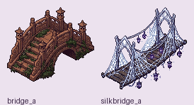

| Sprite | Size | Biomes | Footprint | Life | Source |
|---|---|---|---|---|---|
| `bridge_a` | 123x105 | hqs, earthly | spans a 2-tile stream (mirror to cross along i) | residents cross it; water underneath animates | pixellab create_1_direction_object job f47ea782 |
| `silkbridge_a` | 121x116 | btd, cave | spans a 3-tile chasm along j | silk shimmer; the abyss underneath | pixellab create_1_direction_object job 0caab83e |

## buildings

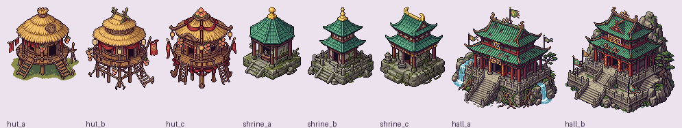

| Sprite | Size | Biomes | Footprint | Life | Source |
|---|---|---|---|---|---|
| `hut_a` | 105x108 | hqs, earthly | 2x2 | residents enter and leave (door POI), lantern glow at night | pixellab create_1_direction_object job 64e8709c |
| `hut_b` | 107x122 | hqs, earthly | 2x2 | residents enter and leave (door POI), lantern glow at night | pixellab create_1_direction_object job 64e8709c |
| `hut_c` | 103x120 | hqs, earthly | 2x2 | residents enter and leave (door POI), lantern glow at night | pixellab create_1_direction_object job 64e8709c |
| `shrine_a` | 84x107 | hqs, heaven | 2x2 | residents pray / sit at the steps | pixellab create_1_direction_object job 0e249abe |
| `shrine_b` | 96x115 | hqs, heaven | 2x2 | residents pray / sit at the steps | pixellab create_1_direction_object job 0e249abe |
| `shrine_c` | 94x118 | hqs, heaven | 2x2 | residents pray / sit at the steps | pixellab create_1_direction_object job 0e249abe |
| `hall_a` | 155x150 | hqs, heaven | 3x3 | landmark; prayers at the stairs | pixellab create_1_direction_object job 4e334cf4 |
| `hall_b` | 161x156 | hqs, heaven | 3x3 | landmark; prayers at the stairs | pixellab create_1_direction_object job 4e334cf4 |

## crystals

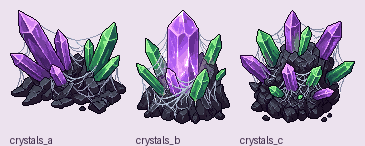

| Sprite | Size | Biomes | Footprint | Life | Source |
|---|---|---|---|---|---|
| `crystals_a` | 116x104 | btd, cave | 1x1 | pulse (glow mask), silk shimmer, lights at night, spores | pixellab create_1_direction_object job cd4218c0 |
| `crystals_b` | 94x114 | btd, cave | 1x1 | pulse (glow mask), silk shimmer, lights at night, spores | pixellab create_1_direction_object job cd4218c0 |
| `crystals_c` | 115x113 | btd, cave | 1x1 | pulse (glow mask), silk shimmer, lights at night, spores | pixellab create_1_direction_object job cd4218c0 |

## heaven

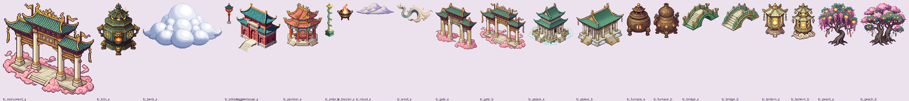

| Sprite | Size | Biomes | Footprint | Life | Source |
|---|---|---|---|---|---|
| `tc_monument_a` | 300x306 | tc | 5x2 landmark | ceremonial gate, integer 2x | pixellab create_1_direction_object job 1348df9c |
| `tc_kiln_a` | 142x175 | tc | 2x2 | trigram fire mouth, smoke and sparks | pixellab create_1_direction_object job 855cdb4e |
| `tc_bank_a` | 260x152 | tc | cloud sea | slow drifting banks | pixellab create_map_object job 445431e5 |
| `tc_silklamp_a` | 28x70 | tc | 1x1 | red lantern glow | pixellab create_map_object job 6507a136 |
| `tc_gatehouse_a` | 145x164 | tc | 2x2 | gatehouse behind main arch | pixellab create_map_object job 94673d0b |
| `tc_pavilion_a` | 128x145 | tc | 2x2 | banquet pavilion | pixellab create_1_direction_object job e2fdc359 |
| `tc_pillar_a` | 30x113 | tc | 1x1 | paired jade huabiao | pixellab create_map_object job 9c2b0f9e |
| `tc_brazier_a` | 52x58 | tc | 1x1 | firelight | pixellab create_map_object job d65dbacd |
| `tc_cloud_a` | 126x38 | tc | cloud sea | slow drift | pixellab create_map_object job 81f96319 |
| `tc_scroll_a` | 117x65 | tc | cloud sea | slow drift | pixellab create_map_object job a81498c0 |
| `tc_gate_a` | 136x155 | tc | 1x1 | gate landmark | pixellab create_1_direction_object job 1348df9c |
| `tc_gate_b` | 150x153 | tc | 1x1 | gate landmark | pixellab create_1_direction_object job 1348df9c |
| `tc_palace_a` | 148x142 | tc | 1x1 | palace landmark | pixellab create_1_direction_object job eac2e662 |
| `tc_palace_b` | 157x147 | tc | 1x1 | palace landmark | pixellab create_1_direction_object job eac2e662 |
| `tc_furnace_a` | 78x110 | tc | 1x1 | flickering glow, rising smoke | pixellab create_1_direction_object job e52bfc0f |
| `tc_furnace_b` | 85x117 | tc | 1x1 | flickering glow, rising smoke | pixellab create_1_direction_object job e52bfc0f |
| `tc_bridge_a` | 120x92 | tc | cloud-channel crossing | walkable bridge over animated cloud stream | pixellab create_1_direction_object job 3c8beb65 |
| `tc_bridge_b` | 123x94 | tc | cloud-channel crossing | walkable bridge over animated cloud stream | pixellab create_1_direction_object job 3c8beb65 |
| `tc_lantern_a` | 86x115 | tc | 1x1 | golden glow | pixellab create_1_direction_object job 380f2729 |
| `tc_lantern_b` | 79x122 | tc | 1x1 | golden glow | pixellab create_1_direction_object job 380f2729 |
| `tc_peach_a` | 130x144 | tc | 1x1 | sway and drifting petals | pixellab create_1_direction_object job c4da708e |
| `tc_peach_b` | 150x143 | tc | 1x1 | sway and drifting petals | pixellab create_1_direction_object job c4da708e |

## misc

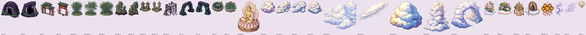

| Sprite | Size | Biomes | Footprint | Life | Source |
|---|---|---|---|---|---|
| `cave_a` | 142x130 |  |  |  | pixellab create_1_direction_object job  |
| `cave_b` | 137x128 |  |  |  | pixellab create_1_direction_object job  |
| `gate_a` | 118x116 |  |  |  | pixellab create_1_direction_object job  |
| `gate_b` | 99x117 |  |  |  | pixellab create_1_direction_object job  |
| `bamboo_a` | 94x116 |  |  |  | pixellab create_1_direction_object job  |
| `bamboo_b` | 106x115 |  |  |  | pixellab create_1_direction_object job  |
| `bamboo_c` | 115x115 |  |  |  | pixellab create_1_direction_object job  |
| `scholar_a` | 92x111 |  |  |  | pixellab create_1_direction_object job  |
| `scholar_b` | 78x117 |  |  |  | pixellab create_1_direction_object job  |
| `lantern_a` | 82x81 |  |  |  | pixellab create_1_direction_object job  |
| `lantern_b` | 78x88 |  |  |  | pixellab create_1_direction_object job  |
| `silkrack_a` | 114x117 |  |  |  | pixellab create_1_direction_object job  |
| `arch_a` | 118x115 |  |  |  | pixellab create_1_direction_object job  |
| `arch_b` | 117x109 |  |  |  | pixellab create_1_direction_object job  |
| `lotus_a` | 87x82 |  |  |  | pixellab create_1_direction_object job  |
| `lotus_b` | 89x88 |  |  |  | pixellab create_1_direction_object job  |
| `buddha_a` | 171x245 |  |  |  | pixellab create_1_direction_object job  |
| `pcloud_a` | 109x95 |  |  |  | pixellab create_1_direction_object job  |
| `pcloud_b` | 110x96 |  |  |  | pixellab create_1_direction_object job  |
| `pcloud_c` | 112x90 |  |  |  | pixellab create_1_direction_object job  |
| `pcloud_d` | 110x99 |  |  |  | pixellab create_1_direction_object job  |
| `pcloudw_a` | 255x223 |  |  |  | pixellab create_1_direction_object job  |
| `pcloudw_b` | 241x148 |  |  |  | pixellab create_1_direction_object job  |
| `pcloudw_c` | 250x224 |  |  |  | pixellab create_1_direction_object job  |
| `pcloudt_a` | 205x240 |  |  |  | pixellab create_1_direction_object job  |
| `pcloudt_b` | 241x213 |  |  |  | pixellab create_1_direction_object job  |
| `plotus_a` | 94x109 |  |  |  | pixellab create_1_direction_object job  |
| `plotus_b` | 115x106 |  |  |  | pixellab create_1_direction_object job  |
| `pwheel_a` | 83x115 |  |  |  | pixellab create_1_direction_object job  |
| `pbell_a` | 111x116 |  |  |  | pixellab create_1_direction_object job  |
| `plantern_a` | 97x118 |  |  |  | pixellab create_1_direction_object job  |
| `pmist_a` | 62x112 |  |  |  | pixellab create_1_direction_object job  |
| `pmist_b` | 101x97 |  |  |  | pixellab create_1_direction_object job  |
| `pride_a` | 46x55 |  |  |  | pixellab create_1_direction_object job  |

## mushrooms

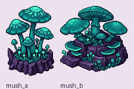

| Sprite | Size | Biomes | Footprint | Life | Source |
|---|---|---|---|---|---|
| `mush_a` | 81x118 | btd, cave | 1x1 | pulse + flicker, rising spores | pixellab create_1_direction_object job 4e93cb98 |
| `mush_b` | 114x111 | btd, cave | 1x1 | pulse + flicker, rising spores | pixellab create_1_direction_object job 4e93cb98 |

## silk-props

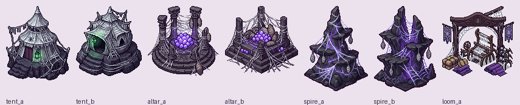

| Sprite | Size | Biomes | Footprint | Life | Source |
|---|---|---|---|---|---|
| `tent_a` | 105x123 | btd, cave | 2x2 | residents enter and leave; silk shimmer, green lantern glow | pixellab create_1_direction_object job 7277f9bd |
| `tent_b` | 108x116 | btd, cave | 2x2 | residents enter and leave; silk shimmer, green lantern glow | pixellab create_1_direction_object job 7277f9bd |
| `altar_a` | 117x116 | btd, cave | 2x2 | sisters tend it; egg glow pulses, silk shimmers, violet spores | pixellab create_1_direction_object job 97819ce3 |
| `altar_b` | 120x112 | btd, cave | 2x2 | sisters tend it; egg glow pulses, silk shimmers, violet spores | pixellab create_1_direction_object job 97819ce3 |
| `spire_a` | 105x141 | btd, cave | 1x1 or 2x2 | silk shimmer | pixellab create_1_direction_object job 3e2ddeec |
| `spire_b` | 102x142 | btd, cave | 1x1 or 2x2 | silk shimmer | pixellab create_1_direction_object job 3e2ddeec |
| `loom_a` | 118x117 | btd, cave | 2x2 | sisters weave here; silk threads run from their sleeves | pixellab create_1_direction_object job cd7a9fd8 |

## stalls

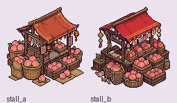

| Sprite | Size | Biomes | Footprint | Life | Source |
|---|---|---|---|---|---|
| `stall_a` | 111x114 | hqs, earthly | 2x2 | residents trade, carry peaches away | pixellab create_1_direction_object job 7d079980 |
| `stall_b` | 114x116 | hqs, earthly | 2x2 | residents trade, carry peaches away | pixellab create_1_direction_object job 7d079980 |

## statues

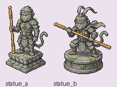

| Sprite | Size | Biomes | Footprint | Life | Source |
|---|---|---|---|---|---|
| `statue_a` | 72x116 | hqs, heaven | 1x1 | landmark | pixellab create_1_direction_object job 9de37e22 |
| `statue_b` | 98x117 | hqs, heaven | 1x1 | landmark | pixellab create_1_direction_object job 9de37e22 |

## trees

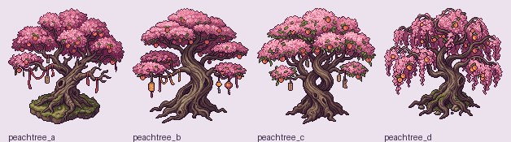

| Sprite | Size | Biomes | Footprint | Life | Source |
|---|---|---|---|---|---|
| `peachtree_a` | 143x143 | hqs, earthly | 1x1 (canopy 2.5 tiles) | sway (6 px strips), drifting petals | pixellab create_1_direction_object job 1423100d |
| `peachtree_b` | 143x142 | hqs, earthly | 1x1 (canopy 2.5 tiles) | sway (6 px strips), drifting petals | pixellab create_1_direction_object job 1423100d |
| `peachtree_c` | 146x143 | hqs, earthly | 1x1 (canopy 2.5 tiles) | sway (6 px strips), drifting petals | pixellab create_1_direction_object job 1423100d |
| `peachtree_d` | 146x137 | hqs, earthly | 1x1 (canopy 2.5 tiles) | sway (6 px strips), drifting petals | pixellab create_1_direction_object job 1423100d |

## village-props

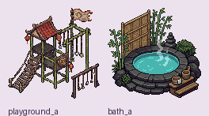

| Sprite | Size | Biomes | Footprint | Life | Source |
|---|---|---|---|---|---|
| `playground_a` | 116x115 | hqs | 2x2 | kids climb the frame and drop down | pixellab create_1_direction_object job 77428071 |
| `bath_a` | 118x114 | btd | 2x2 | not placed yet (hot-spring bath terrace) | pixellab create_1_direction_object job 274abac0 |

## characters

| Name | Biome | Canvas | Animations | Source |
|---|---|---|---|---|
| `wukong` | hqs | 64x64 | idle x4, walk x8, staff-practice | pixellab |
| `khi_linh` | hqs | 60x60 | idle x4, walk x8 | pixellab |
| `khi_lao` | hqs | 60x60 | idle x4, walk x8 | pixellab |
| `khi_con` | hqs | 36x36 | idle x4, walk x8 | pixellab |
| `khi_dan` | hqs | 56x56 | idle x4, walk x8 | pixellab |
| `khi_dan_b` | hqs | 56x56 | idle x4, walk x8 | pixellab |
| `tam_tang` | btd | 64x64 | idle x4, walk x8 | pixellab |
| `sister1_violet` | btd | 64x64 | idle x4, walk x8, silk-weaving | pixellab |
| `sister2_teal` | btd | 64x64 | idle x4, walk x8, silk-weaving | pixellab |
| `sister3_rose` | btd | 64x64 | idle x4, walk x8, silk-weaving | pixellab |
| `sister4_amber` | btd | 64x64 | idle x4, walk x8, silk-weaving | pixellab |
| `sister5_crimson` | btd | 64x64 | idle x4, walk x8, silk-weaving | pixellab |
| `sister6_silver` | btd | 64x64 | idle x4, walk x8, silk-weaving | pixellab |
| `sister7_indigo` | btd | 64x64 | idle x4, walk x8, silk-weaving | pixellab |
| `nhen_con` | btd | 48x48 | idle x4, walk x8 | pixellab |
| `nhen_con_b` | btd | 44x44 | idle x4, walk x8 | pixellab |
| `tc_fairy` | tc | 56x56 | idle x4, walk x8, tend-peach | pixellab |
| `tc_guard` | tc | 60x60 | idle x4, walk x8, guard-watch | pixellab |
| `tc_laojun` | tc | 60x60 | idle x4, walk x8, tend-furnace | pixellab |
| `tc_wukong` | tc | 64x64 | idle x4, walk x8 | pixellab |
| `palm_attendant` | btp | 52x52 | idle x4, walk x8 | pixellab |
